<h1 align="center"><picture><source media="(prefers-color-scheme: dark)" srcset="docs/banner-dark.svg"></picture></h1>

<p align="center">The engine under every TajweedFormer SDK, in portable C. Embed it in C or C++, port it to a new platform, and prove your build gives the same bits.</p>

Most apps do not use this repository directly: they use the SDK for their platform (table below),
which compiles this engine. Use it directly to embed TajweedFormer in C or C++, to port it to a new
platform, or to check a build against the conformance suite.

<p align="center"><picture><source media="(prefers-color-scheme: dark)" srcset="docs/engine-dark.svg"></picture></p>

## What you get

<table>
<tr>
<td width="33%" valign="top">

**The whole pipeline in C**<br>The fbank front end, the model runtime, the streaming API and the tajweed scorer. The tajweed library is portable C11 with no dependencies.

</td>
<td width="33%" valign="top">

**Streaming**<br>Push audio as it arrives and read every head of every chunk, as often as every 160 ms (320 ms by default, 480 ms for longer context).

</td>
<td width="33%" valign="top">

**The checks every SDK ships**<br>Wrong letters and vowels, madd held too short or too long, and a score for every word. Qalqalah checks are experimental.

</td>
</tr>
<tr>
<td valign="top">

**Settings resolved for you**<br>Four presets and three word levels. App code wins, then the portal, then the model's calibration, so a portal change needs no new build.

</td>
<td valign="top">

**Exact, and you can check it**<br>ARMv7 NEON arithmetic everywhere: native on ARM, emulated bit for bit elsewhere. The conformance suite compares 35 clips at every context, bit for bit.

</td>
<td valign="top">

**Drops into your build**<br>One `add_subdirectory` in your CMake project. Presets for Linux, macOS and Windows, and for Android arm64 and armv7.

</td>
</tr>
</table>

## Why TajweedFormer

- **One source of truth.** Every SDK pins this repository as a submodule and compiles it, so iOS, Android, the web, Windows and Linux all run this code.
- **Porting has a finish line.** Bring a C11 compiler and CMake. When every line of the conformance run reads `35/35`, your port matches the reference bit for bit.
- **Offline by design.** Nothing in the engine talks to a network: you feed it audio and a model folder, and it hands back results on the device.
- **Free, and it stays free.** Quran Lab is a non-profit waqf: the engine, the SDKs and the models are never sold. The licence, NPL-1.2, asks three things: no paywall on model features, no results presented as rulings, and show the notice.

## Built for AI developers

[AGENTS.md](AGENTS.md), beside this README, is the full reference written for coding assistants: point yours at it and the code it writes uses names that exist. Building an app rather than a port? Use the SDK for your platform: one prompt from [portal.quranlab.ai](https://portal.quranlab.ai), pasted into your coding assistant, sets everything up.

## The TajweedFormer SDKs

One model, one engine, the same bits on every platform. Each SDK compiles the same engine source
(Quran-Lab/tajweedformer-engine, pinned as a submodule), so no platform can drift from the others.

| Repository | What it is | Platforms | Install |
| - | - | - | - |
| [tajweedformer-android](https://github.com/Quran-Lab/tajweedformer-android) | Kotlin SDK (AAR) | Android 8.0+, desktop JVM | Maven `ai.quranlab:tajweedformer:2.0.0` |
| [tajweedformer-apple](https://github.com/Quran-Lab/tajweedformer-apple) | Swift SDK: Neural Engine (CoreML) with the exact CPU engine as fallback | iOS 15+, macOS 12+ | SwiftPM, product `TajweedFormer` |
| [tajweedformer-web](https://github.com/Quran-Lab/tajweedformer-web) | WebAssembly SDK with SIMD128 | Browsers, Node | npm `@quran-lab/tajweedformer` |
| [tajweedformer-c](https://github.com/Quran-Lab/tajweedformer-c) | C API and server runner with x86 int8 kernels (AVX2, AVX-VNNI, AVX-512 VNNI) | Windows, Linux (x86-64) | CMake (`add_subdirectory`) |
| [tajweedformer-engine](https://github.com/Quran-Lab/tajweedformer-engine) | The engine: exact C runtime, tajweed scorer, conformance suite | everything above | Git submodule |

The model is Quran-Lab/tajweedformer-v4 (`sdk/v4.0`), hosted by Quran Lab and served by
`cdn.quranlab.ai/models` to approved app keys (request access at
[portal.quranlab.ai/access](https://portal.quranlab.ai/access)). SDK 2.0.0 runs V4 only.
Every release's binaries (the AAR and POM, the XCFramework zips, the npm package, the native archives) are
also on `https://cdn.quranlab.ai/sdk/<product>/<version>/`, with a `SHA256SUMS` file, served from six regions.
[portal.quranlab.ai](https://portal.quranlab.ai) is where you create an app, get its developer key,
choose which model revision your users get, and set the tajweed checks (presets, per-class
thresholds) your users see, without shipping a new build.

## Build

Needs CMake 3.24 or newer, Ninja and a C11 compiler (GCC, clang; on Windows MinGW-w64 GCC or clang for
the Microsoft C runtime; MSVC's `cl.exe` is not supported).

```sh
git clone https://github.com/Quran-Lab/tajweedformer-engine
cd tajweedformer-engine
cmake --preset host-release          # Linux, macOS; on Windows: windows-mingw-dev or windows-clang-dev
cmake --build --preset host-release
```

`ZF_RELEASE=ON` is what an app links: the exact configuration is fixed at compile time and the
`ZF_*` environment switches are ignored. Android: `android-arm64` and `android-armv7` presets
(set `ANDROID_NDK_HOME`). To build inside your own CMake project:

```cmake
set(ZF_RELEASE ON)
add_subdirectory(path/to/tajweedformer-engine tajweedformer EXCLUDE_FROM_ALL)
target_link_libraries(my_app PRIVATE zf_tajweed_engine)   # zf_tajweed.h with streams
```

## Use it from C

```c
#include "zf_tajweed.h"

const char *err = NULL;
ZfTajweedOpenOptions o = zf_tajweed_open_default_options();
ZfTajweedModel *m = zf_tajweed_model_open("sdk/v4.0", &o, &err);   /* the default context */
ZfTajweedStream *s = zf_tajweed_stream_create(m, &err);
zf_tajweed_stream_push_audio(s, samples, n);       /* 16 kHz mono float, as it arrives */
zf_tajweed_stream_finish(s);                        /* end of the take */
ZfTajweedHeads h;
zf_tajweed_stream_heads(s, &h);                     /* every head of every chunk */

ZfTajweedConfig *c = zf_tajweed_config_create(m);
zf_tajweed_config_set_preset(c, "balanced");        /* app code wins over the portal */
zf_tajweed_config_set_remote(c, portal_json, len);  /* optional: the portal's tajweed block */
ZfTajweedResult *r = zf_tajweed_score(m, c, &h, surah, ayah, &err);
puts(zf_tajweed_result_json(r));                    /* or zf_tajweed_result_sites() and friends */

zf_tajweed_result_free(r);
zf_tajweed_config_destroy(c);
zf_tajweed_stream_destroy(s);
zf_tajweed_model_close(m);
```

The header documents every call, the threading rules (a model is shared by any number of threads;
one live stream per process) and the model folder layout. `tajweed/FORMAT.md` describes the expected
table (`expected_tj3.zfx`).

## Exactness

Bit-exact means the same thing in every TajweedFormer repository: for the same input, the engine gives
the same tokens and the same value, to the last bit, for every output of every chunk, as ONNX
Runtime's ARM int8 reference running the published V4 model. It is checked on the 35 conformance
clips: the tokens, the chunk count and an FNV-1a fingerprint of every output of every chunk are
compared with `conformance/`, and one bit of difference on one clip is a failure. Paths that cannot
meet this (the Neural Engine, NPUs, anything in fp16) are called approximate and are measured
against the exact engine, never the other way round.

### Check a build yourself

```sh
cmake --preset host-dev && cmake --build --preset host-dev
scripts/fetch-conformance-data.sh data          # the 35 clips (this repository's release assets)
# the model folder sdk/v4.0 from Quran Lab: request access at portal.quranlab.ai/access (NPL-1.2),
# create an app key on the portal, then
QURANLAB_KEY=qlk_v1_... python3 scripts/fetch-model.py model
bench/v4_conformance.sh build/host-dev model/sdk/v4.0 data
```

Every line must read `35/35`; the script exits nonzero otherwise.

## More

Everything in this README plus what is in each folder and the model folder's sizes is in [AGENTS.md](AGENTS.md), written for coding assistants and just as readable for you. The API is documented in its headers: `accel/include/zf/stream.h` (streaming) and `tajweed/include/zf_tajweed.h` (the tajweed library).

## Licence

Quran Lab is a waqf: the SDKs and the models are free to use and are never sold.

The source code in this repository and the TajweedFormer model weights are released under the
Quran-Lab No-Profit License 1.2 ([NPL-1.2](LICENSE)): use, copy, modify and build on them freely,
but never charge for them, for access to them, or for any feature they power. The weights are not
stored in this repository; Quran Lab hosts them itself and serves them to apps by
`cdn.quranlab.ai/models` under the same licence. Request access at
[portal.quranlab.ai/access](https://portal.quranlab.ai/access).

Third-party components keep their own licences, listed in their folders under `third_party/`.
