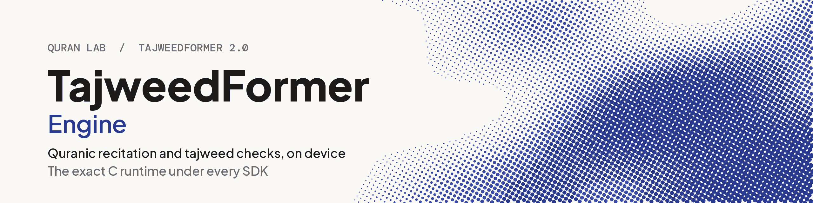

<h1 align="center"><picture><source media="(prefers-color-scheme: dark)" srcset="docs/banner-dark.png"></picture></h1>

<p align="center">The exact C runtime under every TajweedFormer SDK: streaming recognition of Quranic recitation, every head of the network, and calibrated tajweed checks, with the same bits on every platform.</p>

Most apps do not use this repository directly: they use the SDK for their platform (table below),
which compiles this engine. Use it directly to embed TajweedFormer in C or C++, to port it to a new
platform, or to check a build against the conformance suite.

## The TajweedFormer SDKs

One model, one engine, the same bits on every platform. Each SDK compiles the same engine source
(Quran-Lab/tajweedformer-engine, pinned as a submodule), so no platform can drift from the others.

| Repository | What it is | Platforms | Install |
| - | - | - | - |
| [tajweedformer-android](https://github.com/Quran-Lab/tajweedformer-android) | Kotlin SDK (AAR) | Android 8.0+, desktop JVM | Maven `ai.quranlab:tajweedformer:2.0.0` |
| [tajweedformer-apple](https://github.com/Quran-Lab/tajweedformer-apple) | Swift SDK: Neural Engine (CoreML) with the exact CPU engine as fallback | iOS 15+, macOS 12+ | SwiftPM, product `TajweedFormer` |
| [tajweedformer-web](https://github.com/Quran-Lab/tajweedformer-web) | WebAssembly SDK with SIMD128 | Browsers, Node | npm `@quran-lab/tajweedformer` |
| [tajweedformer-c](https://github.com/Quran-Lab/tajweedformer-c) | C API and server runner with x86 int8 kernels (AVX2, AVX-VNNI, AVX-512 VNNI) | Windows, Linux (x86-64) | CMake (`add_subdirectory`) |
| [tajweedformer-engine](https://github.com/Quran-Lab/tajweedformer-engine) | The engine: exact C runtime, tajweed scorer, conformance suite | everything above | Git submodule |

The model, Quran-Lab/tajweedformer-v4 (`sdk/v4.0`), is on Hugging Face (gated: you accept its licence there)
and mirrored by `cdn.quranlab.ai`. SDK 2.0.0 runs V4 only.
Every release's binaries (the AAR and POM, the XCFramework zips, the npm package, the native archives) are
also on `https://cdn.quranlab.ai/sdk/<product>/<version>/`, with a `SHA256SUMS` file, served from six regions.
[portal.quranlab.ai](https://portal.quranlab.ai) is where you create an app, get its developer key,
choose which model revision your users get, and set the tajweed checks (presets, per-class
thresholds) your users see, without shipping a new build.

## What is in here

| Folder | What it is |
| - | - |
| `engine/` | The model runtime: int8 matrix kernels, convolutions, the TajweedFormer layers, the fbank front end and the resampler. ARMv7 NEON arithmetic everywhere: native on ARM, emulated bit for bit (`zf/neon_emu.h`) elsewhere. |
| `accel/` | The graph runner (`zf_rt`) and the streaming API, `accel/include/zf/stream.h`: audio or features in, every output of every chunk out. |
| `tajweed/` | The tajweed library, `tajweed/include/zf_tajweed.h`: opens a V4 model folder, streams audio, keeps every head, resolves the tajweed settings (app code, then the portal, then the model's calibration) and scores a recitation of a known ayah into per-site verdicts. Portable C11, no dependencies. |
| `bench/` | The conformance harnesses and `bench/v4_conformance.sh`. |
| `conformance/` | The expected outputs of the 35 conformance clips at every V4 context. |
| `third_party/` | kissfft (BSD-3-Clause), ARM optimized-routines math (MIT), the ONNX Runtime C API headers (MIT; types only, no runtime is linked). |

## Build

Needs CMake 3.24 or newer, Ninja and a C11 compiler (GCC, clang; on Windows MinGW-w64 GCC or clang for
the Microsoft C runtime; MSVC's `cl.exe` is not supported).

```sh
git clone https://github.com/Quran-Lab/tajweedformer-engine
cd tajweedformer-engine
cmake --preset host-release          # Linux, macOS; on Windows: windows-mingw-dev or windows-clang-dev
cmake --build --preset host-release
```

`ZF_RELEASE=ON` is what an app links: the exact configuration is fixed at compile time and the
`ZF_*` environment switches are ignored. Android: `android-arm64` and `android-armv7` presets
(set `ANDROID_NDK_HOME`). To build inside your own CMake project:

```cmake
set(ZF_RELEASE ON)
add_subdirectory(path/to/tajweedformer-engine tajweedformer EXCLUDE_FROM_ALL)
target_link_libraries(my_app PRIVATE zf_tajweed_engine)   # zf_tajweed.h with streams
```

## Use it from C

```c
#include "zf_tajweed.h"

const char *err = NULL;
ZfTajweedOpenOptions o = zf_tajweed_open_default_options();
ZfTajweedModel *m = zf_tajweed_model_open("sdk/v4.0", &o, &err);   /* the default context */
ZfTajweedStream *s = zf_tajweed_stream_create(m, &err);
zf_tajweed_stream_push_audio(s, samples, n);       /* 16 kHz mono float, as it arrives */
zf_tajweed_stream_finish(s);                        /* end of the take */
ZfTajweedHeads h;
zf_tajweed_stream_heads(s, &h);                     /* every head of every chunk */

ZfTajweedConfig *c = zf_tajweed_config_create(m);
zf_tajweed_config_set_preset(c, "balanced");        /* app code wins over the portal */
zf_tajweed_config_set_remote(c, portal_json, len);  /* optional: the portal's tajweed block */
ZfTajweedResult *r = zf_tajweed_score(m, c, &h, surah, ayah, &err);
puts(zf_tajweed_result_json(r));                    /* or zf_tajweed_result_sites() and friends */

zf_tajweed_result_free(r);
zf_tajweed_config_destroy(c);
zf_tajweed_stream_destroy(s);
zf_tajweed_model_close(m);
```

The header documents every call, the threading rules (a model is shared by any number of threads;
one live stream per process) and the model folder layout. `tajweed/FORMAT.md` describes the expected
table (`expected_tj3.zfx`).

## Exactness

Bit-exact means the same thing in every TajweedFormer repository: for the same input, the engine gives
the same tokens and the same value, to the last bit, for every output of every chunk, as ONNX
Runtime's ARM int8 reference running the published V4 model. It is checked on the 35 conformance
clips: the tokens, the chunk count and an FNV-1a fingerprint of every output of every chunk are
compared with `conformance/`, and one bit of difference on one clip is a failure. Paths that cannot
meet this (the Neural Engine, NPUs, anything in fp16) are called approximate and are measured
against the exact engine, never the other way round.

### Check a build yourself

```sh
cmake --preset host-dev && cmake --build --preset host-dev
scripts/fetch-conformance-data.sh data          # the 35 clips (this repository's release assets)
# the model folder sdk/v4.0 from Hugging Face (gated: accept the licence first)
huggingface-cli download Quran-Lab/tajweedformer-v4 --include "sdk/v4.0/*" --local-dir hf
bench/v4_conformance.sh build/host-dev hf/sdk/v4.0 data
```

Every line must read `35/35`; the script exits nonzero otherwise.

## Model folder sizes

`sdk/v4.0` (manifest format 3) stores the int8 encoder weights once for every context: `layers.zfw` (65.7 MB) and
`frontend.zfw` (1.19 MB) at the top, and per context only the graph and its geometry tensors (`frames.zfw`,
0.3 to 0.7 MB). The CPU profile every SDK downloads for the default context is 56.5 MB gzip (73.5 MB on disk);
each further context adds about 0.85 MB.

## Licence

Quran Lab is a waqf: the SDKs and the models are free to use and are never sold.

The source code in this repository and the TajweedFormer model weights are released under the
Quran-Lab No-Profit License 1.2 ([NPL-1.2](LICENSE)): use, copy, modify and build on them freely,
but never charge for them, for access to them, or for any feature they power. The weights are not
stored in this repository; they are gated on Hugging Face and served to apps by `cdn.quranlab.ai`
under the same licence.

Third-party components keep their own licences, listed in their folders under `third_party/`.
